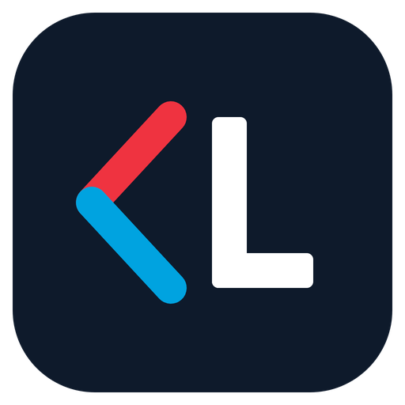
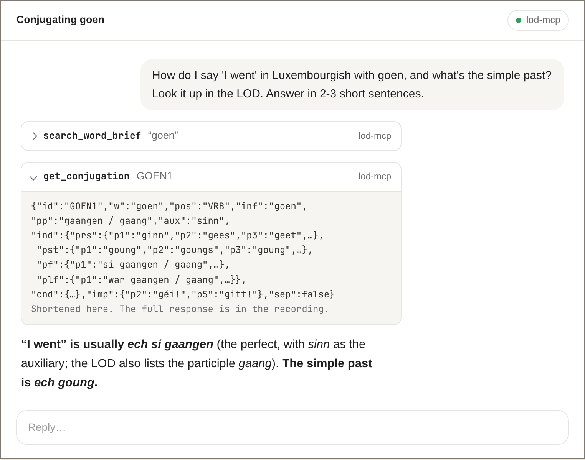
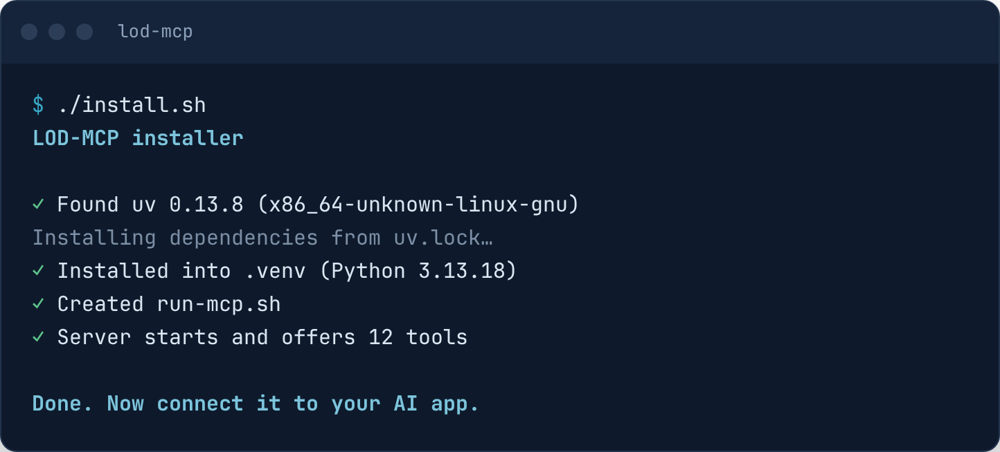
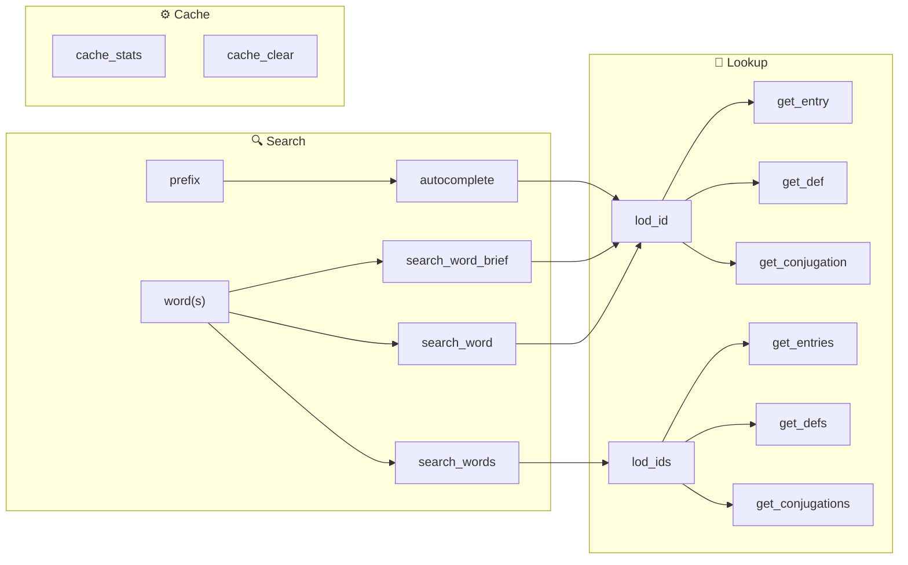

<div align="center">
  
  <h1>LOD-MCP</h1>
  <p><strong>Let your AI assistant look up Luxembourgish in the LOD instead of guessing.</strong></p>
  <p>
    An MCP server for the <a href="https://lod.lu">Luxembourgish Online Dictionary</a>.
    It gives Claude and other MCP apps entries, translations, examples and full verb tables,
    in compact answers that cost the model as few tokens as possible.
  </p>
  <p>
    <a href="https://modelcontextprotocol.io"></a>
    <a href="https://www.python.org/downloads/"></a>
    <a href="https://docs.astral.sh/uv/"></a>
    
    <a href="https://lod.lu/api/doc"></a>
  </p>
</div>

---

## What it looks like

You ask in plain language. The assistant searches the LOD, reads the entry, and answers from it:

<p align="center">
  
</p>

<sub>A real session with Claude Code and only LOD-MCP connected, recorded on 27 Nov 2026 and shown in a plain chat layout. The verb table is shortened here; the [full session](docs/example-session.md) has every call and response.</sub>

## Quick start

You need **[uv](https://docs.astral.sh/uv/getting-started/installation/)**. It downloads Python 3.13 for you if you don't have it.

```bash
# macOS and Linux
curl -LsSf https://astral.sh/uv/install.sh | sh
```

```powershell
# Windows
powershell -ExecutionPolicy ByPass -c "irm https://astral.sh/uv/install.ps1 | iex"
```

Then pick one of the two ways below.

### Option 1: one command, nothing to download

uv fetches LOD-MCP from GitHub and runs it, so there's no folder to keep and no script to run. This also needs [git](https://git-scm.com/downloads).

<details open>
<summary><b>Claude Code</b></summary>

```bash
claude mcp add lod-mcp -- uvx --from git+https://github.com/OpenSprooch/lod-mcp lod-mcp
```

Check it with `claude mcp list`. You should see `lod-mcp: … ✔ Connected`.
</details>

<details>
<summary><b>Claude Desktop</b></summary>

Open **Settings → Developer → Edit Config** and add `lod-mcp` under `mcpServers`:

```json
{
  "mcpServers": {
    "lod-mcp": {
      "command": "uvx",
      "args": ["--from", "git+https://github.com/OpenSprooch/lod-mcp", "lod-mcp"]
    }
  }
}
```

If the file already has other servers, add only the `"lod-mcp": { … }` entry. Quit Claude Desktop completely (Cmd+Q on a Mac) and open it again.

If Claude Desktop says it can't find `uvx`, replace `"uvx"` with the full path that `which uvx` (macOS, Linux) or `where uvx` (Windows) prints.
</details>

<details>
<summary><b>Other MCP apps</b> (Cursor, VS Code, Zed, …)</summary>

Add a **stdio** server with the command `uvx` and the arguments `--from git+https://github.com/OpenSprooch/lod-mcp lod-mcp`. Most apps use the same JSON as Claude Desktop above.
</details>

The first start takes a few seconds while uv downloads everything; later starts are instant. To update to the latest version, run `uvx --refresh --from git+https://github.com/OpenSprooch/lod-mcp lod-mcp` once (stop it with Ctrl+C), then restart your app.

### Option 2: clone and install

Use this if you want to work on LOD-MCP, or to run the exact versions in `uv.lock`. The installer needs bash (macOS, Linux or WSL).

```bash
git clone https://github.com/OpenSprooch/lod-mcp
cd lod-mcp
./install.sh
```

<p align="center">
  
</p>

The installer installs the exact versions in `uv.lock`, writes `run-mcp.sh` (the command your AI app starts), checks that the server starts, and prints the setup lines for your app with your real paths filled in. You can run it again at any time.

Then connect your app with the path it printed:

- **Claude Code:** `claude mcp add lod-mcp -- /path/to/lod-mcp/run-mcp.sh`
- **Claude Desktop and other apps:** use the JSON from Option 1, with `"command": "/path/to/lod-mcp/run-mcp.sh"` and no `args`.

Without bash, run `uv sync --frozen` in the folder instead, and use `"command": "uv"` with `"args": ["--directory", "/path/to/lod-mcp", "run", "--frozen", "lod-mcp"]`.

### Try it

Mention the LOD so the assistant knows to use it:

- *"Look up Gromper in the LOD."*
- *"Conjugate goen with the LOD. What's the simple past?"*
- *"Here's my vocabulary list: Haus, Schoul, schéin, Noper. Check each one in the LOD and give me the English."*
- *"Which words start with schou in the LOD?"*

You should see `lod-mcp` tool calls before the answer.

## How it works

Every lookup has two steps: **search** for a word to get its LOD ID, then **look up** that ID for details.



| Tool | What it does | Key params |
|------|-------------|------------|
| `search_word` | Find words → list of LOD IDs | `word`, `max_results` |
| `search_word_brief` | Find words → `{id: "word (POS)"}` | `word`, `max_results` |
| `search_words` ⭐ | Batch search multiple words | `words[]`, `max_results` |
| `autocomplete` | Type-ahead suggestions | `prefix`, `limit` |
| `get_entry` | Full entry details | `lod_id`, `langs`, `max_examples` |
| `get_entries` ⭐ | Batch entry details | `lod_ids[]`, `langs`, `max_examples` |
| `get_def` | Single-language definition string | `lod_id`, `lang` |
| `get_defs` ⭐ | Batch definitions | `lod_ids[]`, `lang` |
| `get_conjugation` | Verb conjugation table | `lod_id` |
| `get_conjugations` ⭐ | Batch conjugations | `lod_ids[]` |
| `cache_stats` | Cache hit/miss stats | — |
| `cache_clear` | Clear cache | — |

⭐ = prefer these over calling single-word tools in a loop: fewer tool calls and fewer tokens.

### Examples

```
# Search
search_word("haus")              → ["HAUS1", "HAUSEN1"]
search_word_brief("haus")        → {"HAUS1": "Haus (N)", "HAUSEN1": "hausen (V)"}
autocomplete("schou")            → "schoul, schoun, schoulen, schounen, schounend"

# Look up
get_def("HAUS1", "en")           → "Haus: house building; house household, family"
get_entry("GOEN1", langs="en")   → {id, w, pos, ipa, tr, ex, infl, audio …}
get_conjugation("GOEN1")         → {inf, pp, aux, ind, cnd, imp …}

# Batch (recommended for several words)
search_words(["haus","schoul"])  → {"haus": {"HAUS1": "Haus (N)"}, "schoul": {"SCHOUL1": "Schoul (N)"}}
get_defs(["HAUS1","SCHOUL1"])    → {"HAUS1": "Haus: house …", "SCHOUL1": "Schoul: school …"}
```

## Troubleshooting

- **`uv` or `uvx` not found:** install uv (see [Quick start](#quick-start)) and open a new terminal. Apps such as Claude Desktop may need the full path from `which uvx` or `where uvx`.
- **The app doesn't show any `lod-mcp` tools:** restart the app completely. With Option 2, run `./install.sh` again and copy the command it prints, because it must be the full path. In Claude Code, `claude mcp list` shows whether it connects.
- **The server won't start:** run the command yourself (`uvx --from git+https://github.com/OpenSprooch/lod-mcp lod-mcp`, or `./run-mcp.sh`). It should wait silently for input (stop it with Ctrl+C). Any error it prints is the problem.
- **`No module named 'mcp.server.fastmcp'`:** the server was installed without the lockfile and picked up `mcp` 2.x. This version of LOD-MCP pins `mcp` below 2; run Option 1 with `--refresh`, or `./install.sh`.
- **Start fresh:** `rm -rf .venv run-mcp.sh && ./install.sh`

## Privacy

LOD-MCP runs on your computer and only contacts `lod.lu/api`. It sends the words and IDs your assistant looks up, waits at least 100 ms between requests, and keeps answers in memory for an hour. It writes nothing to disk. Your assistant's provider sees the tool results, as with any tool.

## Development

```bash
uv sync --extra dev
uv run ruff check .
uv run python -m pytest -q
```

These are the checks CI runs on every push. `skills/SKILL.md` describes the LOD API directly, for agents that call it without MCP.

## Details

- **Cache:** 1-hour TTL, reduces duplicate API calls
- **Rate-limited:** 100 ms between requests, to respect the LOD API
- **Languages:** German, French, English, Portuguese, Dutch
- **Source:** [LOD API](https://lod.lu/api/doc) by the Luxembourgish Ministry of Culture

<div align="center">
  <sub>Part of <a href="https://github.com/OpenSprooch">OpenSprooch</a>: free, open-source tools for learning Luxembourgish.</sub>
</div>

MIT License
